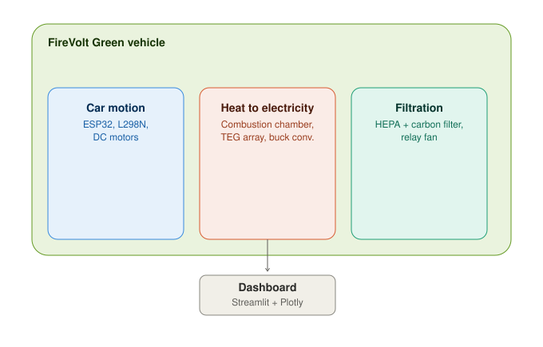
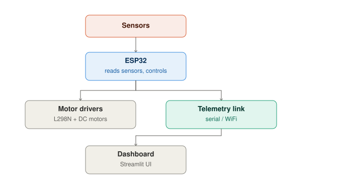
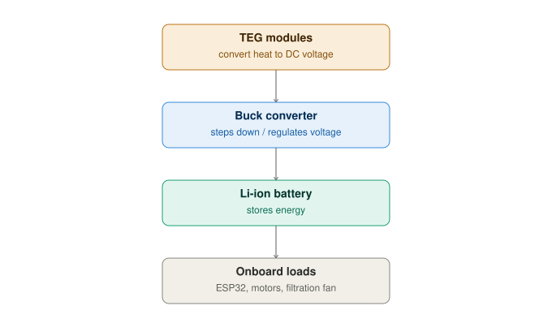
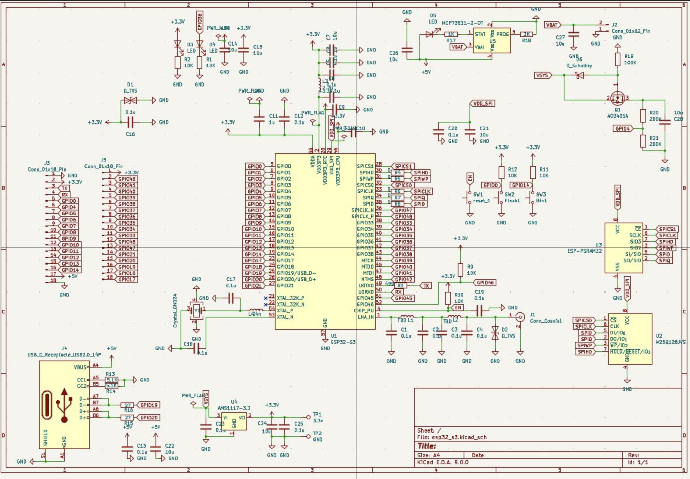
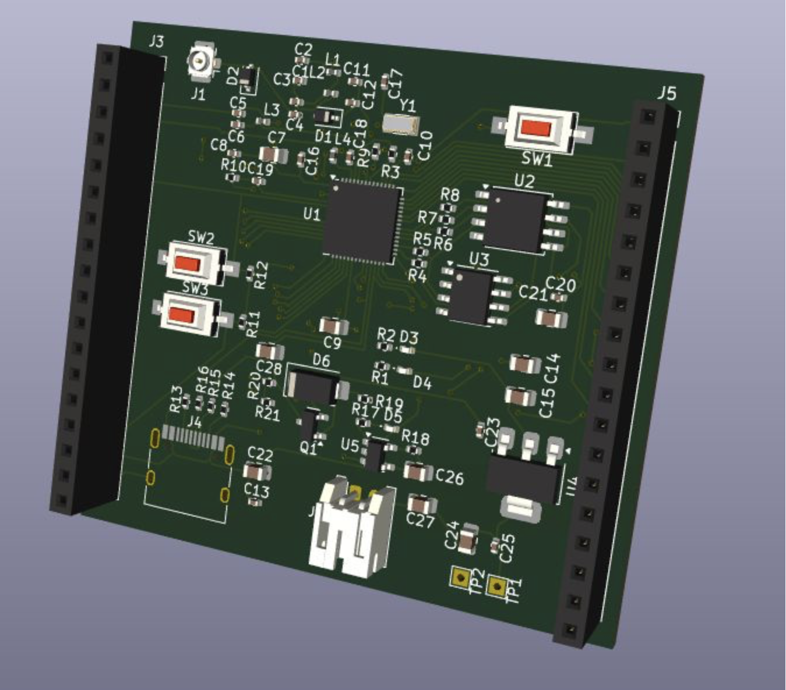
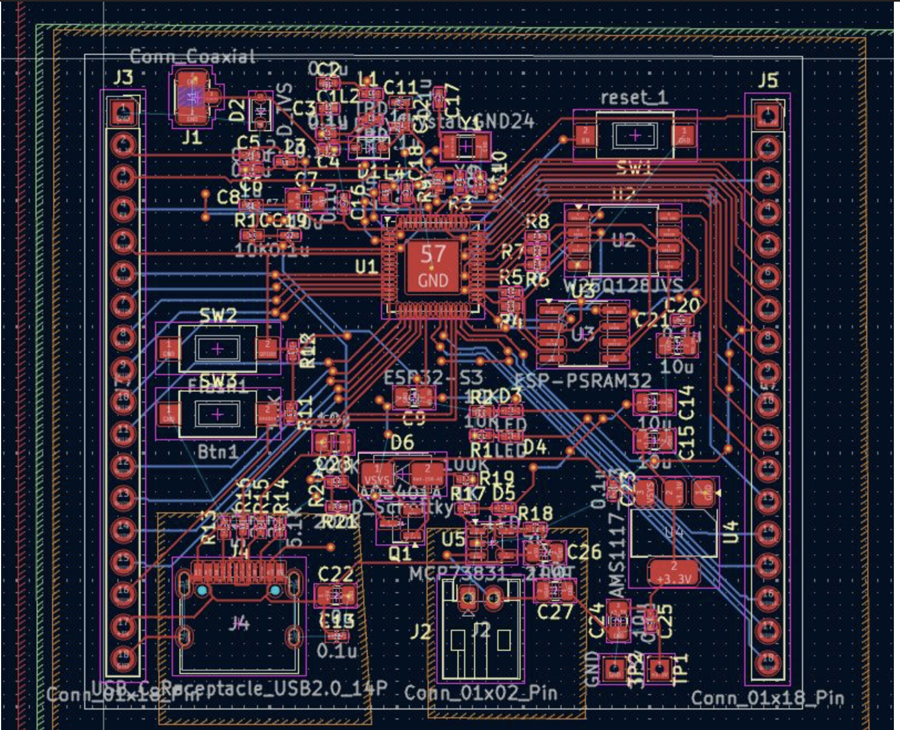
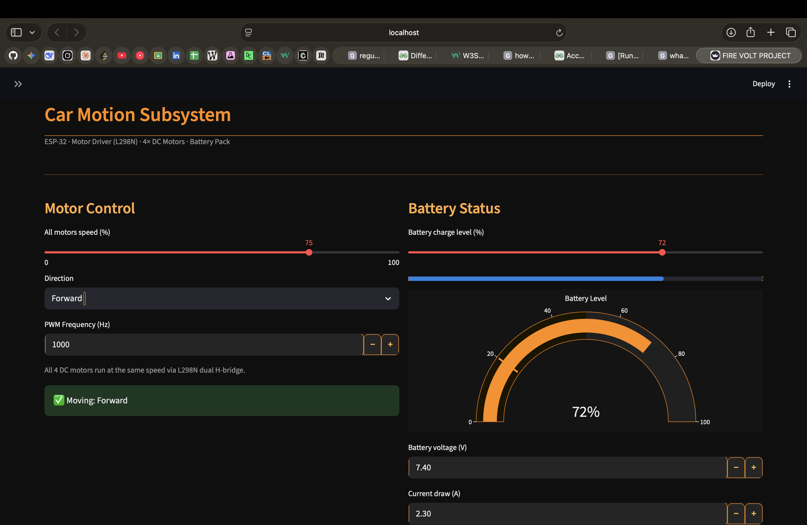
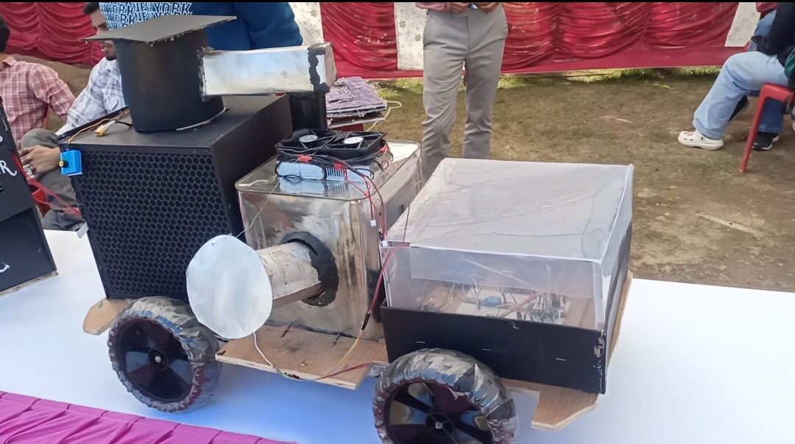
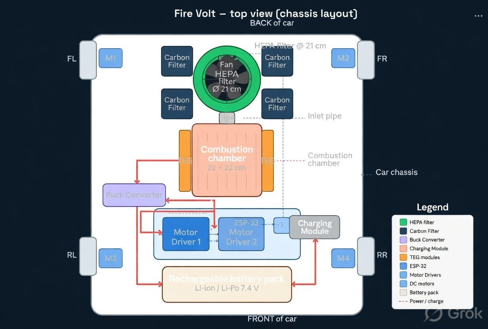

# FireVolt Green

[](https://www.python.org)
[](https://streamlit.io)
[](https://www.espressif.com)
[](https://opensource.org/licenses/MIT)
[](https://github.com/topics/sustainability)
[]()

**A prototype electric agricultural vehicle that burns crop stubble in a controlled chamber and recovers part of the heat as electricity** — tackling India's stubble-burning crisis while pointing to a new revenue stream for farmers.

> Waste → Energy → Revenue: the idea this prototype is built to demonstrate.

---

## Table of Contents
- [About the Project](#about-the-project)
- [The Problem](#the-problem)
- [Key Features](#key-features)
- [Three Subsystems](#three-subsystems)
- [Tech Stack](#tech-stack)
- [System Overview](#system-overview)
- [Power Electronics: Boost & Buck Converters](#power-electronics-boost--buck-converters)
- [Custom ESP32-S3 Board](#custom-esp32-s3-board)
- [Screenshots](#screenshots)
- [Getting Started](#getting-started)
- [Running the Dashboard](#running-the-dashboard)
- [Project Structure](#project-structure)
- [Current Status & Limitations](#current-status--limitations)
- [Roadmap](#roadmap)
- [Contributing](#contributing)
- [License](#license)
- [Team & Acknowledgments](#team--acknowledgments)

---

## About the Project

**FireVolt Green** is a Wi-Fi-controlled agricultural vehicle prototype built to tackle **crop residue (stubble) burning** in India — a practice that torches millions of tonnes of leftover paddy and wheat stalks every harvest season, choking cities in smog and wasting a resource that could otherwise generate income.

Instead of farmers burning stubble in open fields, FireVolt Green burns it in a **controlled combustion chamber**, captures part of the waste heat and converts it into electricity via thermoelectric generator (TEG) modules, filters the resulting emissions through a two-stage filtration system, and collects the captured carbon soot as raw material for **ink production** (the ink-making step itself happens downstream of the vehicle).

The goal is a **circular economy** demonstration: **Waste → Energy → Revenue.** This repository documents the working prototype and is explicit about which parts are built, which are designed only, and which are still planned (see [Current Status & Limitations](#current-status--limitations)).

---

## The Problem

- Post-harvest stubble burning is one of the largest seasonal contributors to air pollution in North India, degrading air quality across entire regions every year.
- Farmers burn stubble because it's the fastest and cheapest way to clear fields before the next planting cycle — there's little economic incentive to do otherwise.
- Existing mechanical solutions (balers, shredders) require upfront investment with no direct energy or revenue payback.

FireVolt Green is designed to change that calculus: the same stubble a farmer would otherwise burn for free becomes fuel for on-board power generation and a marketable soot-ink byproduct.

---

## Key Features

- Controlled combustion of crop stubble in an enclosed chamber (no open-field burning)
- Heat-to-electricity conversion via 12–16 thermoelectric generator (TEG) modules
- Boost converter designed from scratch to raise the low TEG voltage (not the converter used in the demo); a buck converter is used in the demo to charge the battery
- Custom ESP32-S3 board designed in KiCad 9 (schematic + PCB)
- Two-stage filtration (HEPA + activated carbon) for cleaner exhaust
- Captured carbon soot collected as raw material for ink
- Wi-Fi remote control: the ESP32 hosts its own access point and a web UI for driving the vehicle, setting speed and switching the fan relays
- MQ-135 gas sensor with a `/gas` JSON endpoint and a live gas-level readout in the web UI
- Streamlit dashboard for logging and visualizing voltage, temperature, energy and soot data (manual entry and CSV upload)

---

## Three Subsystems

| Subsystem | Main Components | Purpose |
|---|---|---|
| **Car Motion** | ESP32, 2× L298N motor drivers, 4× DC motors, Li-ion battery pack | Wi-Fi remote-controlled (manually driven) vehicle movement across the field |
| **Heat → Electricity** | Combustion chamber, 12–16 TEG modules, custom boost converter (designed), buck converter (used in demo) | Converts waste combustion heat into usable, regulated electrical power |
| **Filtration & Recovery** | HEPA filter (Ø21 cm), activated carbon filter, relay-controlled fan | Cleans exhaust before release and captures soot for ink production |

For a full breakdown of how these subsystems work together — including circuit design, control logic, and engineering trade-offs — see **[Technical_Overview.md](Technical_Overview.md)**. A PDF write-up is also available: **[Fire_Volt_Technical_Manual.pdf](assets/Fire_Volt_Technical_Manual.pdf)**.

---

## Tech Stack

**Dashboard**
- Python
- Streamlit — web dashboard
- Plotly — graphs of logged sensor data
- Pandas — data handling and CSV storage
- Pillow — image display

**Hardware & Firmware**
- ESP32 — main microcontroller: motor control, fan relays, MQ-135 gas sensing, Wi-Fi access point and web server
- Arduino framework (`WiFi.h`, `WebServer.h`) — ESP32 firmware
- MQ-135 — gas sensor
- TEG (thermoelectric generator) modules — heat-to-electricity conversion
- L298N motor drivers — DC motor control
- Single-channel relays — switch the 12 V fans
- Custom boost converter — designed from scratch to raise low TEG voltage
- Buck converter — used in the demo to regulate power into the battery
- Custom ESP32-S3 board — designed in KiCad 9

---

## System Overview

FireVolt Green is organized into three physical subsystems, with a Streamlit dashboard for logging and visualizing their data.



### Data flow

The ESP32 drives the motors and fan relays in real time and reads the MQ-135 gas sensor. The telemetry link to the dashboard shown in the diagram below is **planned and not implemented yet**: in the current version the dashboard is fed by manual entry and CSV upload, not by a live connection to the ESP32.



### Power chain

Heat from burning stubble is converted to DC power by the TEG modules, regulated by the buck converter (demo), and stored in the Li-ion battery, which supplies the vehicle's electronics. TEG output supplements the battery rather than replacing it.




## Power Electronics: Boost & Buck Converters

TEG modules give a **low and changing voltage**, which is too low to charge a battery directly. To fix this, we **designed a boost converter from scratch** to step the TEG voltage up.

For the **demonstration prototype**, we used a **buck converter** instead to regulate the power and store it in the Li-ion battery. The boost converter design is complete, but it is not the converter running in the demo.

| Converter | Role | Status |
|---|---|---|
| **Boost converter** | Raise the low TEG voltage to a usable level | Designed from scratch (not used in the demo) |
| **Buck converter** | Regulate power and charge the battery | Used in the demo |

---

## Custom ESP32-S3 Board

We also designed our own ESP32-S3 board in **KiCad 9**. It includes USB-C, an MCP73831 Li-ion battery charger, an AMS1117-3.3 voltage regulator, external flash and PSRAM, and pin headers.

The images below are exported views of the design; the KiCad project files are not yet included in this repository.

**Schematic**


**3D View**


**PCB Layout**


---

## Screenshots

**Dashboard**


**Side View & Circuit**


**Top View & Circuit**


---

## Getting Started

### Prerequisites
- Python 3.10+
- pip
- (For the vehicle firmware) an ESP32 board and the Arduino IDE with the ESP32 board package installed
- (For the full build) the components listed in [Three Subsystems](#three-subsystems)

### Installation

1. Clone the repository:
   ```bash
   git clone https://github.com/arzaanxeng/Fire_Volt_Green.git
   cd Fire_Volt_Green
   ```

2. Create a virtual environment (recommended):
   ```bash
   python -m venv venv
   source venv/bin/activate   # On Windows: venv\Scripts\activate
   ```

3. Install the dashboard dependencies:
   ```bash
   pip install streamlit pandas plotly pillow
   ```

### Flashing the vehicle firmware

1. In the Arduino IDE, create a new sketch and paste in the contents of `ESP-32_Code/Code.cpp` (or save it as a `.ino` file).
2. Select your ESP32 board and port, then upload.
3. Power the vehicle and connect your phone or laptop to the Wi-Fi access point the ESP32 creates. The SSID and password are set at the top of `Code.cpp` — **change the default password** before using it anywhere beyond a bench demo.
4. Open `http://192.168.4.1` to drive the vehicle, set speed, switch the fan relays and read the gas sensor.

---

## Running the Dashboard

From the repository root:

```bash
cd dashboard
streamlit run fire_volt_dashboard_v5.py
```

The dashboard opens in your browser at `http://localhost:8501`.

- **First launch:** it shows built-in demo data, not measurements.
- **Your own data:** upload a CSV from the sidebar, or log readings through the forms in each tab. Uploaded and logged data is saved in a local `fire_volt_data/` folder, created in the directory you launch from. The sidebar's "Reset to demo data" button deletes the saved files and restores the demo data.
- **CSV format:** a file is recognised by its column names:

| Data | Columns |
|---|---|
| Voltage history | `Time`, `TEG Output (V)`, `Buck Output (V)` |
| Temperature history | `Time`, `Chamber Temp (°C)`, `Ambient Temp (°C)` |
| Energy history | `Session`, `Energy Consumed (Wh)`, `Energy Recovered (Wh)` |

> **Note:** the dashboard is not connected to the ESP32 in this version. The system-health tiles are static labels, not live status.

---

## Project Structure

```
Fire_Volt_Green/
├── ESP-32_Code/
│   └── Code.cpp                       # ESP32 firmware: Wi-Fi AP + web UI, motor control, fan relays, MQ-135 gas sensing
├── assets/
│   ├── Fire_Volt_Technical_Manual.pdf # PDF technical write-up
│   ├── dashboard_screenshot.png       # Dashboard screenshot
│   ├── side_view.jpg                  # Vehicle side view
│   ├── top_view.jpg                   # Vehicle top view
│   ├── diagrams/
│   │   ├── architecture.svg           # System architecture diagram
│   │   ├── dataflow.svg               # Sensor-to-dashboard data flow diagram (telemetry link planned)
│   │   └── powerchain.svg             # Heat-to-battery power chain diagram
│   └── hardware/
│       ├── schematic.png              # KiCad schematic of the ESP32-S3 board
│       ├── board_3d_view.png          # 3D view of the board
│       └── pcb_layout.png             # PCB layout
├── dashboard/
│   ├── fire_volt_dashboard_v5.py      # Streamlit dashboard
│   └── run.txt                        # Quick-start notes
├── README.md
└── Technical_Overview.md              # Deep dive into system design and engineering
```

---

## Current Status & Limitations

This is a working prototype. What is and isn't done:

- **Dashboard is not live.** It is not connected to the ESP32; data comes from manual entry, CSV upload or built-in demo data, and the system-health tiles are static.
- **Limited sensing.** The firmware reads only the MQ-135 gas sensor. It does not measure TEG voltage, chamber temperature or current, and it has no over-temperature protection.
- **Manual driving only.** The vehicle is controlled over Wi-Fi from a web page; there is no autonomous navigation.
- **Boost converter not in the demo.** It is designed, but the buck converter is what ran in the demo, and the converter design files are not in this repository.
- **KiCad project files not included.** Only exported images of the ESP32-S3 board are in the repository.
- **PWM speed control needs verification.** The `ledcSetup` / `ledcAttachPin` lines in `Code.cpp` are commented out, so confirm the speed slider works on your hardware and ESP32 core version before relying on it.
- **Stubble feeding is manual**, and ink production happens downstream of the vehicle.
- **TEG power is supplementary**, not enough for full off-grid operation.

---

## Roadmap

- [ ] Connect the dashboard to live ESP32 telemetry (TEG voltage, chamber temperature, current)
- [ ] Add over-temperature protection for the combustion chamber
- [ ] Integrate the custom boost converter in place of the buck converter, and publish its design files
- [ ] Add the KiCad project files for the ESP32-S3 board
- [ ] Automate stubble-to-chamber feeding mechanism
- [ ] Add GPS-based autonomous field navigation
- [ ] Expand TEG array for higher continuous power output
- [ ] Partner with local farmer cooperatives for a field pilot
- [ ] Explore battery storage sizing for full off-grid operation

---

## Contributing

Contributions are welcome! To contribute:

1. Fork the repository
2. Create a feature branch (`git checkout -b feature/your-feature`)
3. Commit your changes (`git commit -m 'Add some feature'`)
4. Push to the branch (`git push origin feature/your-feature`)
5. Open a Pull Request

For major changes, please open an issue first to discuss what you'd like to change.

---

## License

This project is licensed under the **MIT License** — see the [LICENSE](LICENSE) file for details.

---

## Team & Acknowledgments

Built by **Arzaan** ([@arzaanxeng](https://github.com/arzaanxeng)) and team.

- Connect on [LinkedIn](https://linkedin.com/in/arzaanxeng)
- Report issues or suggest features via [GitHub Issues](https://github.com/arzaanxeng/Fire_Volt_Green/issues)

Special thanks to everyone who contributed hardware testing, field research, and design feedback during prototyping.
